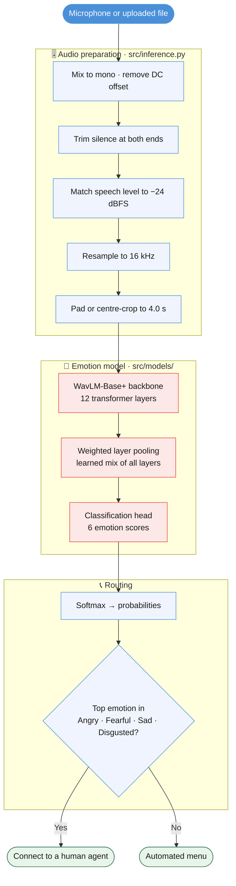

# Emotion-Aware Call Routing


> A speech emotion model that listens to the **one short sentence** a caller says to an
> automated phone system, predicts one of six emotions, and decides whether the caller
> should skip the menu and go straight to a human agent. Built in PyTorch on a fine-tuned
> **WavLM-Base+** backbone, trained on **CREMA-D**, and served through a **Gradio** web demo.

---

## Table of Contents
1. [Overview](#overview)
2. [Results](#results)
3. [Architecture](#architecture)
   - [Inference pipeline](#inference-pipeline)
   - [Model](#model)
   - [Fine-tuning strategies](#fine-tuning-strategies)
4. [Tech Stack](#tech-stack)
5. [Key Characteristics](#key-characteristics)
6. [Project Structure](#project-structure)
7. [Setup & Usage](#setup--usage)
8. [Tests](#tests)
9. [Training from Scratch](#training-from-scratch)
10. [Limitations](#limitations)
11. [Data, Licence & AI Use](#data-licence--ai-use)
12. [Contributors](#contributors)

---

## Overview

Automated call routing usually decides where to send a caller from **what** they say
(keywords in the transcript) and ignores **how** they say it. A calm question and an angry
complaint about the same bill are routed the same way and wait in the same queue.

This project adds the missing signal. From the first utterance of a call it predicts one of
six emotions, then collapses that prediction into a single routing decision:

| Predicted emotion | Route |
|---|---|
| Angry · Fearful · Sad · Disgusted | **Connect to a human agent** |
| Neutral · Happy | Automated menu |

The emotion model was trained on **CREMA-D**: 7,442 short acted clips from 91 actors. CREMA-D
has isolated 2–3 second clips, not whole conversations. So the system makes **one decision
from one utterance**; it does not track a caller's mood over a full call.

The project was built for UCCD3094 Principles of Deep Learning (Assignment 2).

---

## Results

Best model: `crema_d_partial_top4`. It fine-tunes the top four transformer layers of
WavLM-Base+.

| Split | 6-way UAR | Routing balanced accuracy | Escalate recall | Routing false alarm |
|---|---|---|---|---|
| Validation | 0.7511 | 0.8596 | 0.9346 | 0.2155 |
| **Test** (speakers never seen in training) | **0.6961** | **0.8729** | **0.9107** | **0.1648** |

**How to read these numbers**

| Metric | Question it answers |
|---|---|
| **UAR** (unweighted average recall) | Of each emotion, what share did the model get right, averaged so every emotion counts equally? |
| Routing balanced accuracy | How good is the yes/no "send to a human" decision, with both answers weighted equally? |
| Escalate recall | Of the callers who **should** reach a human, what share did? |
| Routing false alarm | Of the callers who **should not** reach a human, what share were sent anyway? |

Plain accuracy is never the headline. CREMA-D has fewer Neutral clips than other emotions,
and accuracy would flatter a model that ignores the rarer classes.

**Fine-tuning comparison (validation split)**

| Model | Strategy | Trainable parameters | 6-way UAR |
|---|---|---|---|
| `crema_d_partial_top4` | Top 4 layers unfrozen | 28.6 M (30.2%) | **0.7511** |
| `lora_e30` | LoRA, rank 8 | 0.49 M (0.52%) | 0.6272 |
| `frozen_probe` | Backbone frozen, head only | 0.20 M (0.21%) | 0.6265 |
| `crema_d_lora_r16` | LoRA, rank 16 | 0.79 M (0.83%) | 0.6230 |

Full table, routing numbers for both escalate groupings, and per-emotion recall:
[`results/master_table.md`](results/master_table.md). Every number in this README has a run
JSON in [`results/`](results/) behind it.

---

## Architecture

### Inference pipeline

What happens between pressing **Analyse emotion** and seeing the result.



> Level matching and the 4-second window copy the conditions the model was trained under.
> A very quiet or very long recording is brought into that range before the model sees it.

### Model

| Part | Role |
|---|---|
| `microsoft/wavlm-base-plus` | Pre-trained speech model (~94 M parameters). Turns raw audio into a sequence of feature vectors. Its convolutional feature extractor is always frozen. |
| Weighted layer pooling | Learns one weight per transformer layer and mixes their outputs. Different layers carry different information; the model picks the useful mix. |
| Masked mean over time | Averages the frames into one vector, ignoring the padding added to short clips. |
| Classification head | One hidden layer (256 units), then six scores, one per emotion. |

### Fine-tuning strategies

One config key, `model.finetune_strategy`, switches between four strategies so the
comparison is a one-line change:

| Strategy | What is trained |
|---|---|
| `frozen` | Only the pooling weights and the head. The backbone is untouched. |
| `lora` | Small low-rank adapters on the attention `q_proj` and `v_proj` matrices (`peft`). |
| `partial` | The top *N* transformer layers (`partial_unfreeze_layers: 4`) plus pooling and head. **Best result.** |
| `full` | Every transformer layer. |

More diagrams (data splitting, module wiring, training loop):
[`docs/ARCHITECTURE.md`](docs/ARCHITECTURE.md).

---

## Tech Stack

**Model & training**
| Component | Library |
|---|---|
| Deep learning framework | PyTorch (`torch`, `torchaudio`) |
| Pre-trained backbone | Hugging Face `transformers` · `microsoft/wavlm-base-plus` |
| LoRA adapters | `peft` |
| Metrics | `scikit-learn` |
| Config | `PyYAML` with `--override key.path=value` |
| Training compute | Google Colab GPU |

**Audio**
| Component | Library |
|---|---|
| Reading files | `soundfile`, with `scipy.io.wavfile` and stdlib `wave` as fallbacks |
| Resampling and signal work | `numpy`, `scipy` |

**Demo**
| Component | Library |
|---|---|
| Web UI (record, upload, results) | Gradio 6 |

---

## Key Characteristics

### 1. Speaker-independent splits
CREMA-D has every actor reading the same 12 sentences. A random split would put the same
voice in training and testing, and the model could score well by recognising the person
instead of the emotion. Splits are made **by actor** (70/15/15, seed 1337), so the test set
contains only voices the model has never heard. `scripts/smoke_test.py` asserts that no
actor appears in two splits.

### 2. Validation for every decision, test opened once
Learning rate, epoch and strategy were all chosen on the validation split. The test split
was scored once, at the end, on the final model only. The test numbers above are
confirmation, not a tuning target.

### 3. Six emotions in, one routing decision out
The model trains on CREMA-D's own six labels. The routing decision is computed **after**
prediction by grouping emotions, so the grouping can change without retraining.
`scripts/routing_analysis.py` re-scores a finished run under any grouping with no GPU.

### 4. Training-matched audio preparation
Real microphone recordings differ from studio clips in level, length and silence. The demo
trims edge silence, matches loudness to −24 dBFS and fits the clip to the 4-second training
window, so a user's recording looks like what the model learned from.

### 5. Two views of the same result
The demo has a **View for** switch in the top-right corner. **General visitor** shows the
emotion and the decision in plain words. **Technical** adds level, window and timing
details. Switching re-words the current result without running the model again.

### 6. Reproducible and checkable
Every result is a JSON file in `results/` with its full config. The trained checkpoint is
published as a GitHub Release with a SHA-256 checksum, and the download script refuses a
file that does not match.

---

## Project Structure

```
.
├── app.py                         # Gradio web demo: record/upload, analyse, show emotion and route
├── Launch Speech Emotion Demo.bat # Windows double-click launcher for app.py
├── requirements.txt               # Python dependencies
│
├── src/
│   ├── inference.py               # Checkpoint loading, audio checks and cleanup, prediction
│   ├── data/                      # CREMA-D filename parsing, labels, speaker splits, Dataset
│   ├── models/                    # WavLM wrapper, layer pooling, heads, fine-tuning strategies
│   ├── train/                     # Training loop, loss, evaluation, checkpointing
│   ├── evaluation/                # Six-way metrics and the binary routing collapse
│   └── utils/                     # Seeding
│
├── scripts/
│   ├── download_checkpoint.py     # Fetch the trained model from the GitHub Release
│   ├── prepare_crema_d.py         # Build the manifest and speaker-independent splits
│   ├── audit_dataset.py           # Open every clip; find corrupt, silent or duplicate audio
│   ├── train.py                   # Train one configuration
│   ├── routing_analysis.py        # Re-score saved predictions as a routing decision
│   └── smoke_test.py              # Fast end-to-end check, no dataset or GPU needed
│
├── configs/crema_d_baseline.yaml  # Baseline config; change one setting per run with --override
├── notebooks/colab_train.ipynb    # Thin Colab notebook: clone, install, call train.py
├── tests/                         # pytest: audio preparation, inference, UI layout, download
├── results/                       # master_table.md and every run / routing JSON
├── docs/                          # Architecture diagrams, demo spec, design notes
│
├── checkpoints/                   # Downloaded model goes here (gitignored)
└── data/                          # CREMA-D goes here for training (gitignored)
```

---

## Setup & Usage

### 1. Prerequisites

- Python 3.11 or newer (tested on 3.13)
- About 1 GB of free disk for the backbone and checkpoint
- A CPU is enough for the demo; no GPU needed

### 2. Clone the repository

```bash
git clone https://github.com/qing123777/emotion-aware-call-routing.git
cd emotion-aware-call-routing
```

### 3. Create a virtual environment and install dependencies

```bash
python -m venv .venv
```

```bash
# Windows (PowerShell)
.venv\Scripts\Activate.ps1

# macOS / Linux
source .venv/bin/activate
```

```bash
pip install -r requirements.txt
```

### 4. Download the trained checkpoint

The checkpoint is 114 MB, over GitHub's 100 MB limit for files in a repository, so it is
attached to [Release v1.0](https://github.com/qing123777/emotion-aware-call-routing/releases/tag/v1.0)
instead.

```bash
python scripts/download_checkpoint.py
```

The script saves it to `checkpoints/crema_d_partial_top4_best.pt` and checks its SHA-256.

### 5. Start the demo

```bash
python app.py --inbrowser
```

The first start also downloads the `microsoft/wavlm-base-plus` backbone (~360 MB) into the
Hugging Face cache. Later starts are fast. If no browser opens, go to
<http://127.0.0.1:7860>.

On Windows, after steps 1–4, `Launch Speech Emotion Demo.bat` starts the demo with a
double-click.

### 6. Use it

1. Record a short sentence with the microphone, or upload an audio file.
2. Press **Analyse emotion**.
3. Read the predicted emotion, the routing decision and the probability for each emotion.
4. Use **View for** in the top-right corner to switch between plain and technical wording.

Behaviour, input limits and error messages: [`docs/UI_demo_spec.md`](docs/UI_demo_spec.md).

---

## Tests

```bash
python scripts/smoke_test.py
```

```bash
python -m pytest tests
```

| Check | What it covers | Needs |
|---|---|---|
| `scripts/smoke_test.py` | Data splitting and leakage, model wiring, all four fine-tuning strategies, metrics, the training loop | Nothing: builds a tiny fake corpus and a dummy backbone, runs in under a minute on CPU |
| `tests/` | Audio preparation, prediction, both UI views, the Gradio layout, checkpoint download | Nothing: uses a stand-in model, no checkpoint |

---

## Training from Scratch

Training needs a GPU. It was run on Google Colab through
[`notebooks/colab_train.ipynb`](notebooks/colab_train.ipynb), but the scripts run anywhere.

```bash
git clone https://github.com/CheyneyComputerScience/CREMA-D.git data/raw/CREMA-D
```

```bash
python scripts/prepare_crema_d.py --audio-dir data/raw/CREMA-D/AudioWAV
```

```bash
python scripts/train.py --config configs/crema_d_baseline.yaml --run-id my_run --override model.finetune_strategy=partial
```

The best model used `partial` with 4 unfrozen layers, learning rate 1e-4, batch size 8 with
2 gradient-accumulation steps, up to 30 epochs with early-stopping patience 5. It stopped
after 19 epochs; its best epoch was 14.

---

## Limitations

- **Acted speech.** CREMA-D is 91 actors reading 12 fixed sentences in a studio, not real
  callers on a phone line.
- **One utterance only.** Each decision uses one 2–4 second clip. There is no tracking of
  mood across a whole call.
- **Happy vs Angry.** Both are loud, high-energy speech, so the model sometimes confuses
  them. A delighted caller can be sent to a human as if they were upset.
- **No intensity.** 81.7% of CREMA-D clips have no intensity label, so only the six emotions
  are trained.

More detail: [`docs/REPORT_NOTES.md`](docs/REPORT_NOTES.md) §7.

---

## Data, Licence & AI Use

- **Code** is released under the [MIT License](LICENSE). You may use, change and share it,
  including commercially, as long as the licence notice stays with it.
- **CREMA-D** is free from <https://github.com/CheyneyComputerScience/CREMA-D> under the
  Open Database License. It is not stored in this repository.
- **WavLM-Base+** is published by Microsoft on Hugging Face as
  [`microsoft/wavlm-base-plus`](https://huggingface.co/microsoft/wavlm-base-plus).
- **AI assistance** (Claude Code) was used for parts of the code. The per-file log is in
  [`AI_USE.md`](AI_USE.md).

---

## Contributors

1. [Lim Qing](https://github.com/qing123777)
2. [Chong Jin An](https://github.com/Kane-JediPhilosopher)
3. [Leong Hao Lin](https://github.com/mleong07)
