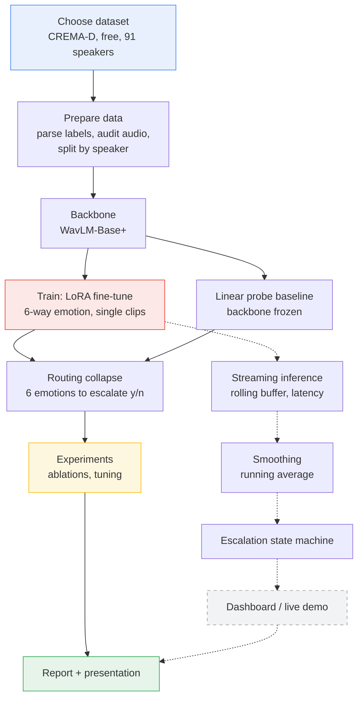
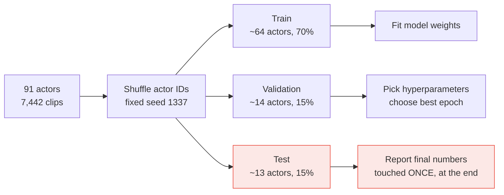
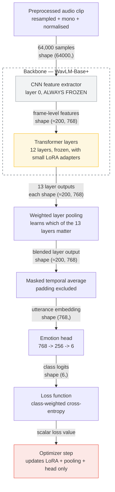
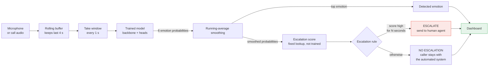
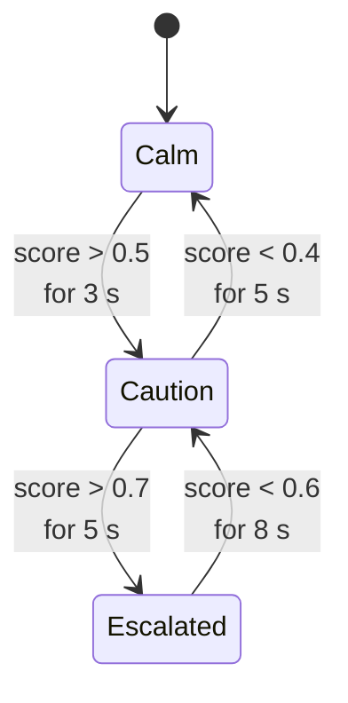
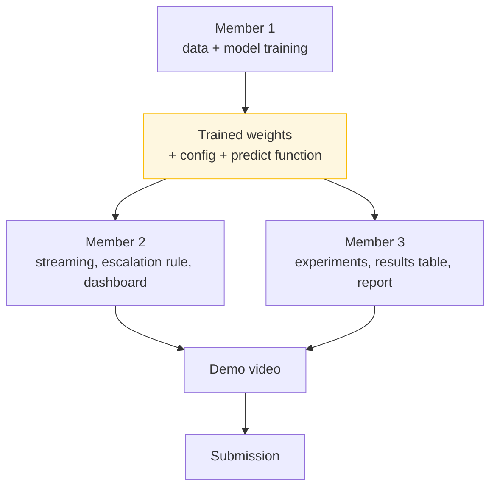

# System Architecture

Emotion-aware call routing from a single caller utterance — UCCD3094 Assignment 2.

**This document owns "how the system works and how the modules fit together."** It is the
thing to read before opening `src/`. Neighbouring documents own other topics and are linked
where relevant rather than summarised:

- *Why* each decision was taken, and what is done vs. outstanding → [`PROJECT_PLAN.md`](../PROJECT_PLAN.md)
- Report framing, limitations, references, and a **step-by-step numeric walkthrough of the
  same architecture** → [`docs/REPORT_NOTES.md`](REPORT_NOTES.md) §3.3.1
- Current results → [`results/master_table.md`](../results/master_table.md)

> **The escalation state machine and dashboard (§6) are a demonstration, not an evaluated
> result.** The project's decision is made once, from one utterance. §6 is kept because it
> earns its place in the presentation video, but it must be labelled a demonstration
> wherever it appears. See "No continuous monitoring" in
> [`PROJECT_PLAN.md`](../PROJECT_PLAN.md)'s decisions log.

---

## 1. The whole project, end to end

Solid arrows are the evaluated system. **Dashed is the demonstration branch** (§6) — real
software, but no measured result depends on it.

**Evaluation is not a final step.** The baseline runs alongside training, so that when the
fine-tuned model produces a number you immediately know whether it is any good.

Note that WavLM-Base+ **cannot** be evaluated before fine-tuning. It has no emotion head,
only generic speech features, so there is nothing to score. The "before" reference point is
the **linear probe**: freeze the backbone completely and train only the small classifier and
pooling weights on top. That measures exactly what fine-tuning adds — which, on this task,
turned out to be almost nothing (see [`results/master_table.md`](../results/master_table.md)).

---

## 2. Data splitting — why not 80/20

We use **three** splits, not two, and we split by **speaker**, not by clip.

**Why three and not two.** If you tune your learning rate by checking the same 20% each
time, you have quietly fitted your choices to that 20%. Its score is then optimistic and no
longer an honest estimate of new data. The validation split absorbs that; the test split
stays sealed until the very end.

**Why split by speaker.** CREMA-D has all 91 actors saying the same 12 sentences. A random
clip-level split would put actor 1042 in both training and testing, and the model could
score well by recognising *that person's voice* rather than learning emotion. Splitting by
actor means the test set contains only voices the model has never heard — which is the
condition a real call centre operates under. `scripts/smoke_test.py` asserts no actor
appears in two splits.

---

## 3. Which pre-trained model, and why

**Recommendation: `microsoft/wavlm-base-plus`.**

| Candidate | Size | Why / why not |
| --- | --- | --- |
| **WavLM-Base+** ✅ | ~94M | Trained with speaker-overlap and denoising objectives, which makes it strong on *how* something is said rather than *what* is said. Best fit for emotion. Runs comfortably on a free GPU. |
| wav2vec2-base | ~95M | The classic baseline. Fine, slightly weaker on paralinguistic tasks. Good as a comparison arm. |
| HuBERT-base | ~95M | Comparable to wav2vec2. No strong reason to prefer it here. |
| WavLM-Large | ~316M | Better scores, especially for valence — but ~3x slower per step. Reserved for a **single final confirmation run** with the best config, plus one ablation row. Running the whole grid on it would cut the number of experiments to roughly a third, and the grid is what the experiments mark rests on. |
| Whisper encoder | varies | Very robust to noise. Worth considering for the telephony experiment. |

The audEERING model `wav2vec2-large-robust-12-ft-emotion-msp-dim` is **not** our backbone —
it is our published-model comparison, run unmodified.

Two things constrain how it can be compared, and both are easy to get wrong:

- It outputs **arousal / valence / dominance**, not emotion categories, so it **cannot** be
  scored on the six-way metric at all. The only common ground with our models is the binary
  escalate/not decision, reached by thresholding its arousal and valence.
- Those thresholds are chosen on the **validation** split, like every other decision in this
  project. The test split is opened once, at the end, for the final chosen configuration —
  not for baseline calibration.

---

## 4. Labels and corpora

### What the model actually trains on

CREMA-D's own six emotion categories. Intensity is built but switched off (81.7% of clips
are tagged `XX`). Arousal/valence are derived from predicted probabilities at *inference*
time for the dashboard only, never trained on and never described as ground truth — the
mapping is a fixed lookup computed from the same labels, so it carries no extra information.
Rationale and the ruled-out licensed corpora: decisions log in
[`PROJECT_PLAN.md`](../PROJECT_PLAN.md); report-facing wording: `docs/REPORT_NOTES.md` §3.1.

### Corpus roles

| Corpus | Role | Why |
| --- | --- | --- |
| **CREMA-D** ✅ | Primary — all training and headline results | Clean audio, emotion carried purely by delivery, and 91 actors so entire speakers can be held out |
| **MELD** | Secondary, three specific jobs only | Real conversation with transcripts included, but laugh track and overlapping speech contaminate the audio, and six recurring main characters make held-out speakers impossible |
| **RAVDESS** | Secondary — cross-corpus test | Free, different recording setup |
| Own recording | Demo material only | A staged 2-minute escalating call, no labels needed |

MELD's three jobs: the audio-vs-audio+text valence experiment, a cross-corpus
generalisation test, and — optionally — a genuinely trained temporal model, since it has
real conversational sequence. Only CREMA-D is used so far.

**The valence limitation** — anger and excited happiness are acoustically similar, and
separating them is an open problem the project characterises rather than solves — is a
report-facing argument with two supporting experiments. It is owned by
[`docs/REPORT_NOTES.md`](REPORT_NOTES.md) §7 and `PROJECT_PLAN.md` Phase 5; not repeated here.
Worth knowing while reading the code: it is why `HAP→ANG` is the largest confusion in every
run so far, and why the routing collapse matters — several dominant confusions fall *within*
one routing group and stop being errors.

---

## 5. Model architecture (training)

*Shapes shown are per single utterance (batch dimension omitted). `T ≈ 200` is the number of
frames the CNN produces from a 4 s window; it varies slightly with each clip's exact length
before padding.*

Grey boxes are frozen — locked, never learning. **The CNN feature extractor is locked no
matter which strategy you pick** — we don't even offer the option to unlock it, because doing
so is a well-known way to break fine-tuning, and our dataset is far too small to teach it
anything better than the generic sound knowledge it already has.

**The pooling weights and the emotion head always train, even under `frozen`** — they're
small separate pieces bolted onto the big pretrained backbone, not part of it. What changes
between `lora`, `full`, and `partial` is only whether the *backbone itself* is allowed to
change. This is the part people misread most: `frozen` is not a crippled, half-working model —
it's a real, fair linear probe, just with a locked backbone underneath.

**Four dials to choose from** — set with `model.finetune_strategy` in the config, coded in
`src/models/finetune.py`. Here's what each one actually changes about the backbone:

| Strategy | What moves in the backbone | Trained here |
| --- | --- | --- |
| `frozen` | Nothing — completely locked | `frozen_probe`, **0.6265 UAR** |
| `partial` | The top *N* transformer layers unlock (`partial_unfreeze_layers` in config); the rest stay locked | not yet run — Phase 5 |
| `full` | The entire backbone unlocks and trains | not yet run — Phase 5 |
| `lora` | Backbone stays locked; small trainable low-rank adapter matrices are attached to it (`q_proj`/`v_proj`, rank 8) | `lora_e30`, **0.6272 UAR** |

So far we've only actually run two of the four — [`results/master_table.md`](../results/master_table.md)
shows they came out basically tied, a gap small enough to call noise rather than a real
difference. `full` and `partial` are still waiting: they're two of the Phase 5 experiments,
and each is just one `--override model.finetune_strategy=...` flag away from happening.

**Weighted layer pooling is a cheap trick that's earning its keep.** WavLM has 13 internal
layers, and each one notices different things — emotion doesn't only hide in the very last
one. So instead of grabbing just the last layer, we let the model learn how much to trust
each of the 13 (only ~13 extra numbers to learn) and blend them together.

> **Want the exact numbers at each step, a worked example, and a plain-language picture of
> how 13 layers become 1?** See [`docs/REPORT_NOTES.md`](REPORT_NOTES.md) §3.3.1 — that's
> the detailed version of this diagram; this page is just the summary.

Arousal, valence, and the escalation score are **worked out from the model's predictions
after it's done its job** — the model was never trained to predict them directly. See
section 4.

---

## 6. System architecture (live inference) — demonstration only, not evaluated

**The model's window is always a fixed 4 seconds — that never changes.** What that means in
practice, and what it costs us:

- **Audio of 4 seconds or less — the current pipeline already handles this.** Short input is
  padded up to 4 seconds, and the model knows to ignore the padded part (the masked temporal
  average in §5). This is the case the whole project is built around: one short utterance,
  one routing decision.
- **Audio longer than 4 seconds — the single-utterance demo centre-crops one window and says
  so in the result details.** Everything in the diagram above that would analyse the complete
  recording — the rolling buffer, taking a new window every second, smoothing, and the state
  machine — is **designed but not built**.

That missing piece is tracked as **streaming inference + escalation state machine** in
[`PROJECT_PLAN.md`](../PROJECT_PLAN.md)'s "What's not done yet". It is a demonstration for
the presentation video, **not** part of the evaluated system — every number this project
reports comes from the single-utterance path above.

### The escalation rule is a state machine, not a threshold

The "turn the alarm on" number and the "turn it back off" number are different on purpose.
If they were the same number, the alarm would flicker on and off every time the score
wobbled near that line. Making it noticeably harder to switch off than to switch on keeps
the display calm and readable. And requiring the score to stay high for several seconds —
not just one instant — stops a single loud laugh from triggering a false alarm.

### What the agent actually sees

Two things only, both updating live as the call goes on:

1. **Status banner** — the escalate decision: colour plus a single word, large enough to read
   across a desk. This is the headline; it's the whole point of the project.
2. **Detected emotion**, smaller, underneath. This is what shows a viewer *why* the banner
   says what it says — watching the emotion shift as the speaker's tone changes is what
   demonstrates the model is genuinely tracking the voice, not flashing at random.

No graph, no plotted curve. Keeping it to two text readouts keeps the demo readable from
across a room during the presentation.

---

## 7. Who builds what

**Handing off the trained model means passing along four things, not just one file.** The
weight file by itself is useless to anyone else:

1. the weight file
2. the config YAML that produced it — window length, sample rate, backbone name
3. the label ordering, so index 3 is known to mean "angry"
4. a single `predict(audio) -> scores` function, callable without understanding the model

Items 1–3 are already taken care of: every time we save a checkpoint, `checkpoint_payload()`
(in `scripts/train.py`) bundles the config, the label order, and the backbone name right into
the same `.pt` file as the weights — and the file stays small (~0.8–2 MB) because it only
holds the trainable slice, not the full ~400 MB backbone. **Item 4 is now implemented** in
`src/inference.py`. It reconstructs the backbone, overlays the trainable checkpoint tensors,
validates and prepares audio, and returns a typed six-probability result used by `app.py`.

---

## 8. Build order

> These step numbers are a different counting system from `PROJECT_PLAN.md`'s Phase 0–6
> (which tracks tasks and marks) — this table is only about **what has to happen before
> what, technically**. Where the two overlap, the right-hand column names the matching
> plan phase.

| Step | What | Blocked by | Status · plan phase |
| --- | --- | --- | --- |
| 1 | Data pipeline, splits, audit, smoke test | — | ✅ done · Phase 1 |
| 2 | Backbone + pooling + head + fine-tuning strategies | step 1 | ✅ done · Phase 3 |
| 3 | Baselines: linear probe, audEERING published model | step 2 | ◑ probe done, audEERING not · Phase 2 |
| 4 | Ablations and tuning | step 2 | ⬜ not started · **Phase 5 — 35% of the grade** |
| 5 | `predict(audio) -> scores` helper | step 2 | ✅ done · Phases 4/6 |
| 6 | Streaming loop + latency measurement | step 5 | ⬜ not started · Phase 4 |
| 7 | Smoothing + escalation state machine | step 6 | ⬜ not started · Phase 4 |
| 8 | Single-utterance dashboard / live mic demo | step 5 | ✅ done · Phase 6 |
| 9 | Report, slides, video | step 4 | ◑ scaffold only · Phase 6 |

Steps 3 and 4 don't depend on each other, and neither one blocks the demo branch — they're
separate people's work, so they can happen at the same time.

### Step 5 vs step 7 — easy to confuse, very different jobs

Both sound like "the live part," but one is the foundation everything else
stands on and the other is a small piece sitting on top of it:

| | `predict(audio) -> scores` **(step 5)** | Smoothing + escalation state machine **(step 7)** |
| --- | --- | --- |
| **What goes in** | one audio clip | a *stream* of scores, one per second |
| **What comes out** | 6 emotion probabilities for that clip | a stable state: Calm / Caution / Escalated |
| **Does it remember anything?** | No — stateless. Same audio in, same answer out, every time | Yes, that's its whole job — it holds the smoothed value and the current state between updates |
| **Does it touch the model?** | Yes — this *is* the model wrapper: load the checkpoint, read the config, apply the label order, run the forward pass | No. Plain arithmetic and if-statements over numbers step 5 already produced |
| **Who needs it** | everyone — the mic demo, the streaming loop, the escalation demo | only the streaming demo |
| **If it's missing** | nothing downstream can be built at all | you still have a working single-utterance demo, just no live status light |

In one line: step 5 answers *"what emotion is in this 4 seconds?"*; step 7 answers *"given
the last few answers, should we alert now?"* Step 5 now powers the local app, while steps 6–7
remain an optional streaming extension.
