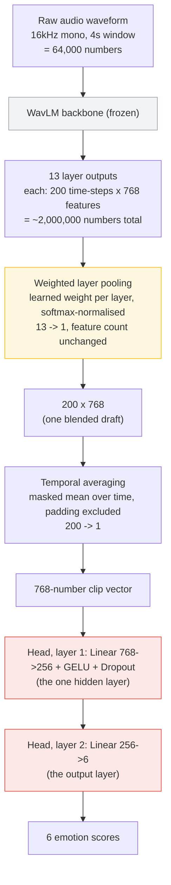

# Report source material

Single place for everything the report is built from: the agreed framing, the facts
behind each claim, and the references. Keeps this material out of `PROJECT_PLAN.md`
(which tracks tasks) and `README.md` (which tells someone how to run the code).

**Sections below are ordered to match the course report template (not included)** — Introduction, Related
Work, System Design, Experiment & Evaluation, Conclusion, AI Use Declaration,
References — so each maps directly onto the section you're writing.

> **This file is not report text.**
>
> The assignment brief requires that AI is not used to draft report content — only
> formatting, editing and proofreading. Everything below is a **scaffold**: the agreed
> structure and the evidence, written down so nothing gets lost between now and
> September. **Rewrite it in your own words before anything goes in the report.**
>
> The reference list and the fact-to-source mapping are research notes, not prose, and
> can be used directly. Every citation still needs to be read before it is cited.

---

## 1. Introduction — scaffold, rewrite before use

> ### How to present this section
>
> **Do not motivate the single-utterance framing as a dataset limitation.** Introduce it
> from the *application* side: callers are stuck talking to an automated system, routed
> on transcribed keywords alone, with no account taken of how distressed they sound.
> Emotion-aware routing at that first utterance is the proposed improvement.
>
> The "what changed, and why" note further down is internal project history — it
> explains to *us* why the scope is what it is. It is not the story the report tells.
> CREMA-D's constraints still appear in the report, but under **limitations** (§7 below)
> and as a **challenge** the design works around, not as the motivation.

### Motivation — why it matters

Malaysia's contact centre and business process outsourcing sector employs over 300,000
people [7]. Telecommunications providers operate under regulatory obligations on
complaint resolution times [8], and the Association of Banks in Malaysia publishes
service standards for its members [9]. Speed of response is a regulated, measured
concern, not a soft one.

Automated call routing still triages on *what* a caller says — transcribed keywords —
and ignores *how* they say it. A calm enquiry and an angry complaint about the same
billing issue are routed identically and wait identically.

Prior work identifies anger as the emotion of primary interest in call centres [5], and
recent systems apply self-supervised speech models to this setting [1]. Local work on
emotional speech has largely used classical machine learning methods [10][11].

### Problem statement

> Given a single short utterance spoken by a caller to an automated system, can we
> determine reliably enough to act on it whether that caller requires immediate
> escalation to a human agent?

Evaluated as a binary routing decision derived from six-way emotion classification, on
speakers never heard during training, with deployment readiness assessed along three
axes: fairness across speaker demographics, robustness to telephone-quality audio, and
calibration of the confidence used to trigger routing.

### Challenges — why it is difficult

- **No public corpus of real, continuous call-centre conversations with time-aligned
  emotion labels exists.** Teams working on exactly this problem have had to build their
  own [3]. This is why the system decides from a single opening utterance rather than
  monitoring a call continuously — the unit of decision is chosen to match what data
  genuinely exists, not the other way round.
- **Anger and excited happiness are acoustically similar** — both loud, fast and
  high-pitched — a difficulty noted as far back as [5] and still open.
- **Features that perform well on clean, acted corpora do not reliably transfer to
  uncontrolled call-centre acoustics** [2], which motivates the telephony-robustness
  experiment.

### Scope and objectives

- **A binary routing metric is reported alongside unweighted average recall.** The
  six-way score measures the model; the routing decision measures the application. The
  gap between them is itself a result.
- **False alarm rate is a headline number**, because under this framing it has a
  concrete business meaning: the fraction of calm callers who would be wrongly
  fast-tracked.
- **The streaming escalation view is a qualitative demonstration**, not an evaluated
  result. It must be labelled as such wherever it appears.
- The system is **audio-only by design** — see the fixed-script limitation in §7 for why
  this is a property of the corpus, not an oversight.

### What changed, and why (internal record — see the callout above before writing)

The original framing was *continuous monitoring of a call, warning the agent as a caller
escalates*. Two of its load-bearing ideas — "continuous" and "escalating" — describe
change over time across a conversation. CREMA-D contains no conversations: it is 7,442
isolated clips of 2–3 seconds. Those claims had no ground truth behind them.

The fix was to move the decision point rather than change the dataset. Inside a
customer-service interaction there is a moment where the decision genuinely is made from
one short utterance with no prior context: the automated system at the start of the call,
which asks the caller to say why they are calling. That unit matches CREMA-D exactly.

| What the task needs | What CREMA-D provides |
| --- | --- |
| One short utterance | 2–3 second clips |
| One speaker, no conversation | one actor per clip |
| Decision made immediately | no history required |
| Many different voices | 91 actors, demographically diverse |

---

## 2. Related work (optional) — scaffold, rewrite before use

The template allows organising this by group. A natural grouping here is by what each
piece of prior work establishes:

- **Call-centre SER as an active industrial problem.** [1] applies self-supervised
  speech models to call-centre emotion recognition end-to-end — the closest published
  system to this project's approach (WavLM-family backbone, task head).
- **Why clean-corpus performance does not transfer.** [2] shows features that win on
  controlled recordings degrade in real acoustic environments — the basis for this
  project's telephony-robustness experiment.
- **Why no conversational corpus is used.** [3] documents that teams needing continuous,
  time-aligned call-centre emotion labels had to build their own corpus — no public one
  exists at the scale or quality this project could use.
- **Text adds information acoustics alone does not carry.** [4] measures a gap between
  audio-only and audio+text emotion recognition in call-centre conversations — the basis
  for this project's MELD text-vs-audio experiment.
- **The historical anger-focus.** [5] is the earliest identification of anger as the
  call-centre emotion of primary interest, and the origin of grouping anger/fear/agitation
  against calm — the same logic behind this project's routing grouping.
- **Local (Malay/English/Mandarin) work predates deep learning approaches** [10][11],
  which is worth a sentence contrasting classical-ML local work against this project's
  self-supervised approach.

---

## 3. System design — scaffold, organise by pipeline stage

The template suggests organising this section as: data collection → data preprocessing →
network architecture → training. That order is used below.

### 3.1 Data collection

CREMA-D: 7,442 clips, 91 actors, 6 categorical emotions, 4 intensity levels, freely
downloadable [13]. Chosen over MSP-Podcast/IEMOCAP (real dimensional ratings but require
a university data-transfer agreement) and over building a proprietary corpus (out of
scope for a 4-week assignment).

### 3.2 Data preprocessing

- Filename parsing into (actor, sentence, emotion, intensity); one known corpus typo
  (`_X` instead of `_XX`) normalised rather than dropped.
- **Speaker-independent split** — partitioned by actor, not by clip, so no voice appears
  in more than one split. A random clip-level split would leak identity and let the
  model succeed by recognising *who* is speaking rather than *how* they sound.
- Every clip resampled to 16kHz mono, fixed to a 4-second window (random crop for
  training, centre crop for evaluation), padded with silence when shorter, with the real
  (unpadded) length tracked so the model can exclude padding from pooling.
- Full-corpus audit (`scripts/audit_dataset.py`) — every one of the 7,442 files opened
  and checked, not just their filenames. Findings worth citing: 0 corrupt/unreadable
  files, 1 near-silent clip, 3 duplicate-audio pairs, and clips averaging 2.5s inside the
  4s window — meaning **36.5% of every training window is padding**, not speech. This is
  the evidence behind the window-length ablation (2s/4s/6s).
- Class-weighted loss: neutral has roughly 4x fewer clips than the other five emotions;
  weights are inverse-frequency, normalised to mean 1, so a mistake on a rare class costs
  proportionally more.

### 3.3 Network architecture

**Backbone: WavLM-Base+** [14]. WavLM was not built for emotion recognition, or for any
single downstream task — it is a general-purpose self-supervised speech model, trained
by masking parts of unlabelled audio and predicting what belongs there, with noise and
overlapping speech deliberately added during pretraining for robustness. Its intended use
(stated in the original paper) is as a shared backbone across a benchmark of speech
tasks (transcription, speaker identification, speaker separation, and others) — general
acoustic description, not classification of any kind. It therefore ships with **no
emotion head**: for a 4-second clip it outputs roughly 200 time-steps × 768 features ×
13 internal layers (~2,000,000 numbers), none of them labelled. This is why a
task-specific head must be trained on top, and why "load a pretrained model" alone would
not solve this project's problem — WavLM alone cannot name an emotion.

**On top of the backbone, three learned pieces reduce those ~2,000,000 numbers to 6
scores:**

1. **Weighted layer pooling** — blends the 13 layers into one (768 numbers per
   time-step) using a learned weight per layer, rather than only using the last layer as
   is conventional for text models. Speech-model layers specialise: lower layers retain
   pitch and voice quality, higher layers drift toward WavLM's own pretraining objective.
   Costs ~13 parameters; the learned weights are plotted as a figure.
2. **Temporal averaging** — collapses the ~200 time-steps into one 768-number vector per
   clip, masked so padded silence is excluded from the average.
3. **Classification head** — two linear layers (768→256→6) mapping the pooled vector to
   one score per emotion.

**Fine-tuning strategy: LoRA** [15], compared against `full`/`partial`/`frozen` behind
one config switch (an ablation, not just an implementation choice). **Important
precision for this section:** the classification head and layer-pooling weights train
under *every* strategy, including `frozen` — they are separate parameters from the
backbone. What LoRA (or `full`/`partial`) additionally allows is the **backbone itself**
adapting during training, via small low-rank adapter matrices rather than updating all
94 million backbone parameters directly. The `frozen` strategy (backbone completely
unchanged, only head + pooling trained) is this project's **linear probe** — the
"before fine-tuning" reference point that measures what fine-tuning specifically added.

### 3.3.1 Architecture walkthrough, with a worked example

Self-contained explainer — useful for onboarding a teammate as well as for writing this
section. Still a scaffold: reword before it goes in the report.

**The metaphor.** Picture a chain of 13 translators sitting in a row. Translator 1 gets
the original sentence and translates it; each translator after that revises the previous
one's draft. You get to see *every* translator's draft, not just the last. Translator 1's
draft stays close to the raw sound (pitch, loudness); Translator 13's has been revised so
many times it drifts toward whatever WavLM's own pretraining objective cared about, which
is not emotion. Nobody knows in advance which translator's draft best captures emotion —
so instead of picking one, **weighted layer pooling blends all 13 drafts into a single
draft**, using a learned trust score per translator. Nothing is discarded; a low-trust
layer still contributes, just less.

**The diagram**, with the actual shape of the data at every stage:

**Every component, what it does, and whether it trains:**

| Component | Role | Shape in → out | Trains under `frozen`? | Trains under `lora`/`full`/`partial`? |
| --- | --- | --- | --- | --- |
| WavLM backbone | Turns raw audio into 13 layers of acoustic description | 64,000 → 13 × (200×768) | No | `lora`: small adapters only · `full`: all of it · `partial`: top N layers |
| Weighted layer pooling | Blends the 13 layers into one, by learned trust | 13×(200×768) → 200×768 | **Yes** | **Yes** |
| Temporal averaging | Collapses time into one summary vector, ignoring padding | 200×768 → 768 | Yes (not learned — a fixed average) | Yes (not learned) |
| Head, hidden layer | Learned compression of the clip vector | 768 → 256 | **Yes** | **Yes** |
| Head, output layer | Produces the final per-emotion score | 256 → 6 | **Yes** | **Yes** |

Note there is **one** hidden layer (256-wide), not two — the head is two `Linear`
operations (768→256, then 256→6), with the first one counting as "hidden" and the second
producing the final output. Worth being precise about this in the report, since "two
hidden layers" overstates it slightly.

**A worked example, small numbers so the arithmetic is followable.**

Real WavLM numbers can't be given individual meanings — nobody named them, they emerged
from training. So this example uses invented numbers, at a toy scale (3 layers of 1
number each, instead of 13 layers of 768), purely to show the *mechanics*:

1. **Three layers describe the same instant of audio** with one number each:
   `layer A = 2.0`, `layer B = -1.0`, `layer C = 5.0`.
2. **Layer pooling has learned to trust them differently**, say 20% / 10% / 70%:
   `blended = 0.2×2.0 + 0.1×(-1.0) + 0.7×5.0 = 3.8`.
   In the real model this same sum runs independently for all 768 numbers at every one
   of the ~200 time-steps, reusing the *same* 13 learned trust scores everywhere — which
   is why layer pooling costs only ~13 parameters total, not thousands.
3. **Temporal averaging**, over a toy 4 time-steps where the last is padding
   (`mask = [1, 1, 1, 0]`), values `[3.8, 4.0, 3.6, 0.0]`:
   `masked mean = (3.8 + 4.0 + 3.6) / 3 = 3.8` — the padded zero is excluded, not averaged in.
4. **The head** takes this clip-level vector (768 numbers, in the real model) and runs it
   through the two learned layers above, ending in 6 numbers — one score per emotion.
   Whichever score is highest is the model's guess for that clip.

That is the entire path from a raw waveform to a prediction: **describe (WavLM) → blend
depth (layer pooling) → blend time (averaging) → decide (head).**

### 3.4 Training

Class-weighted cross-entropy loss, AdamW optimiser, learning rate `1e-4` with linear
warmup (10% of steps) then decay — the low rate and warmup avoid disrupting what the
pretrained backbone already knows in the first few steps. Checkpointed every epoch
(Colab sessions can end without warning); best-epoch weights restored and saved
separately from the last epoch. Early stopping on validation UAR, patience 5.

---

## 4. Experiment & evaluation — scaffold, rewrite before use

### Metrics

- **Unweighted average recall (six-way)**, not accuracy — CREMA-D is imbalanced across
  emotions, and accuracy would flatter a model that ignores rare classes.
- **Routing balanced accuracy (binary)** — the six-way score measures the model; this
  measures the application's actual decision (escalate vs not).
- **False alarm rate** — the share of ordinary (calm/happy) callers wrongly fast-tracked.
  Under this project's framing this has a direct business meaning, so it is reported as
  a headline number, not buried in a confusion matrix.

> **Two distinct numbers are both named "false alarm rate" in this codebase.** A run's
> `metrics` block counts only calm (`NEU`) callers predicted `ANG`/`DIS`;
> `scripts/routing_analysis.py` counts everyone outside the escalate group who got
> escalated, over a much larger benign set, and is always the higher figure. Pick one for
> the report, define it explicitly in the text, and do not mix them between tables.

**Where the numbers live:** [`results/master_table.md`](../results/master_table.md) is the
canonical comparison table; `PROJECT_PLAN.md` holds the per-run history. Every figure traces
back to a local `results/<run_id>.json`, whose `config` block records exactly what produced it.
Google Drive remains a backup rather than the only copy of this evidence.

### Deployment-readiness axes (the experiments spine)

Fairness across speaker demographics, robustness to telephone-quality audio, and
calibration of the confidence used to trigger routing — chosen because all three are
answerable on data already held, all three are cheap, and all three produce a finding
whichever way the result comes out.

### Fact-to-source mapping

Nothing in the report asserts any of these without the matching source. The last column
is a hint for which report section each fact most likely supports — not a hard rule.

| Claim | Source | Likely used in |
| --- | --- | --- |
| Anger is the emotion of primary interest for call centres | [5] | Introduction |
| Anger, happiness and fear are acoustically similar; early work groups them as "agitation" vs "calm" | [5] | Introduction / Limitations |
| Self-supervised speech models are being applied to call-centre emotion recognition industrially | [1] | Introduction / Related work |
| No public corpus of real call-centre conversations with continuous emotion labels exists; researchers build their own | [3] | Introduction / Related work |
| Features that win on clean corpora do not transfer to uncontrolled call-centre acoustics | [2] | Related work / Experiment (telephony) |
| Linguistic content adds measurable information over acoustics in call-centre emotion recognition | [4] | Related work / Experiment (MELD) |
| Malaysia's contact centre / BPO sector employs over 300,000 people | [7] | Introduction (motivation) |
| Malaysian telcos face regulatory complaint-resolution timeframes | [8] | Introduction (motivation) |
| Malaysian banks publish customer service standards | [9] | Introduction (motivation) |
| Malay-language speech emotion work has largely used classical machine learning | [10][11] | Related work |
| Modern neural networks are systematically overconfident; temperature scaling corrects it | [6] | System design / Experiment (calibration) |

Every experimental number additionally requires a matching `results/<run_id>.json`.

---

## 5. Conclusion — scaffold, fill in once results are final

Not drafted. Two of the three baselines exist; the published-model baseline and the whole
ablation grid do not, so the numbers below may still move. When writing this section:

- State the headline result (six-way UAR, false alarm rate) **and** the routing result,
  since they answer different questions (§4).
- Name the gap between "how good is the model" and "how good is the decision" — how many
  six-way errors the routing collapse rescues — as a result in its own right, not a
  footnote. Currently ~215 of 1,142 validation clips.
- Future extensions: pull from `PROJECT_PLAN.md` Phase 5 (the ablation grid, WavLM-Large
  confirmation run, cross-corpus test) rather than inventing new ones here.

### The fine-tuning result, and how to report it honestly

**LoRA fine-tuning did not beat the linear probe.** `lora_e30` scored 0.6272 and
`frozen_probe` 0.6265 — a 0.0007 gap on 1,142 clips, which is noise. Both runs used the same
config, manifest, seed, epoch budget and patience; the only difference was
`model.finetune_strategy`. Numbers and the controlled-comparison check:
[`results/master_table.md`](../results/master_table.md).

This is a **result, not a failure**, and it is more interesting than "fine-tuning helped by
3%" would have been. It says the emotional information is already linearly available in
WavLM-Base+'s frozen representations, and adapting the backbone adds nothing on top.
Candidate explanations to discuss (and, where cheap, to test in Phase 5): only ~5,200
training clips; LoRA rank 8 on `q_proj`/`v_proj` may be too little capacity to matter;
`lora_e30` hit the 30-epoch ceiling rather than converging, so a longer budget might separate
them. Say which of these were tested and which are conjecture.

**One thing not to do:** an earlier version of this comparison had `lora_e30` at 0.5859 and
apparently *losing* to the probe. That was a mismatched early-stopping patience (3 vs 5), not
a finding, and the run was redone. Do not quote 0.5859 — no results file supports it. Worth a
sentence in the report's methodology about matched budgets, since it is exactly the kind of
error the marking rubric rewards catching.

---

## 6. AI use declaration

Not duplicated here — the brief requires this as its own report section, and the
underlying record is auto-maintained in [`AI_USE.md`](../AI_USE.md). Condense that file
into the report's declaration at submission time; do not draft this section from this
file.

---

## 7. Limitations to declare

Stating these is worth more than hoping a marker misses them. Each is tagged with where
it most naturally surfaces in the report.

- **Acted, not spontaneous** *(Introduction — challenges, or Limitations)*. CREMA-D
  actors performed emotions on cue. A real caller fourteen minutes into hold music is
  more restrained, tired and sarcastic. The gap is not measured here.
- **Simulated channel, not simulated situation** *(Experiment discussion — telephony)*.
  Telephone degradation reproduces what the network does to the sound. It cannot
  reproduce how people actually speak on a phone — raising the voice and
  over-articulating in noise — nor real room acoustics.
- **Fixed script** *(Introduction — scope)*. All CREMA-D actors speak the same 12
  sentences, so lexical content carries no emotional signal by construction. This
  isolates tone cleanly, and is why the system is audio-only. It also means the
  text-versus-audio question cannot be answered on this corpus (answered instead via
  MELD, a secondary corpus).
- **Valence is characterised, not solved** *(Experiment discussion / Conclusion)*.
  Separating anger from excitement acoustically is an open problem, grouped away
  deliberately as far back as [5]. Two mitigating factors are argued rather than assumed:
  customer-service callers are rarely happy, and under binary routing several of the
  dominant confusions fall within a single routing group. Both need measuring, not
  asserting.
- **Proxy arousal/valence is display only** *(System design, if the dashboard is shown)*.
  Derived from predicted class probabilities by a fixed table; never described as ground
  truth.
- **Single corpus, single language** *(Conclusion — future work)*. Cross-language
  transfer is untested unless the EMO-DB or RAVDESS cross-corpus experiment is run.

---

## 8. References

IEEE style, to be finalised in the report. **Access status is recorded because nothing
should be cited unread.**

- [1] J. M. Martín-Doñas et al., "Speech Emotion Recognition for Call Centers using
  Self-supervised Models: A Complete Pipeline for Industrial Applications," *Proc.
  ICNLSP 2024*, pp. 119–128. — open access, <https://aclanthology.org/2024.icnlsp-1.14/>
  **Closest published work to this project.**
- [2] L. F. Parra-Gallego and J. R. Orozco-Arroyave, "Classification of Emotions and
  Evaluation of Customer Satisfaction from Speech in Real World Acoustic Environments,"
  *Digital Signal Processing*, 2021. Preprint: arXiv:2108.11981. — preprint open access.
  **Justifies the telephony-robustness experiment.**
- [3] Y. Feng and L. Devillers, "End-to-End Continuous Speech Emotion Recognition in
  Real-life Customer Service Call Center Conversations," arXiv:2310.02281, 2023. — open
  access. **Justifies why no conversational corpus was used.**
- [4] "Acoustic and linguistic representations for speech continuous emotion recognition
  in call center conversations," arXiv:2310.04481. — open access. Author list to be
  confirmed. **Supports the valence / text-vs-audio argument.**
- [5] V. A. Petrushin, "Emotion in Speech: Recognition and Application to Call Centers,"
  1999. — **Origin of the anger-focus and the agitation-vs-calm grouping.**
- [6] C. Guo, G. Pleiss, Y. Sun and K. Q. Weinberger, "On Calibration of Modern Neural
  Networks," *ICML*, 2017. — standard reference for temperature scaling.
- [7] "Beyond the Call: How Malaysia's Contact Centre Industry is Shaping the Nation's
  Digital and CX Future," Malaysia SME. — trade press, **not peer reviewed**; use for
  industry scale only, and prefer an official source if one can be found.
- [8] Malaysian telecommunications complaint-resolution obligations (MCMC framework).
  — **replace with the primary MCMC document before submission.**
- [9] Association of Banks in Malaysia, "Customer Service Charter — Service Standards."
  <https://www.abm.org.my/wp-content/uploads/2022/11/Revised-Customer-Service-Charter-EN.pdf>
- [10] "Influences of languages in speech emotion recognition: A comparative study using
  Malay, English and Mandarin languages." — **most relevant local citation**; paywalled,
  check UTAR library access.
- [11] "Emolah: A Malay Language Spontaneous Speech Emotion Recognition on iOS Platform,"
  *Int. J. Engineering and Technology*. — uses Naïve Bayes; supports the claim that local
  work predates modern deep learning approaches.
- [12] "Intelligent Call Prioritization Using Speech Emotion Recognition,"
  doi:10.1007/978-981-19-8742-7_9, Springer. — **could not be accessed; author list
  unverified. Do not cite until read.**
- [13] H. Cao et al., "CREMA-D: Crowd-sourced Emotional Multimodal Actors Dataset,"
  *IEEE Trans. Affective Computing*, 2014. — the dataset paper. **Required citation.**
- [14] S. Chen et al., "WavLM: Large-Scale Self-Supervised Pre-Training for Full Stack
  Speech Processing," *IEEE J. Sel. Topics Signal Process.*, 2022. — the backbone.
  **Required citation.**
- [15] E. J. Hu et al., "LoRA: Low-Rank Adaptation of Large Language Models," *ICLR*,
  2022. — the fine-tuning method. **Required citation.**

---

## 9. To verify before submission

Not part of the report structure — a standalone checklist.

- [ ] Read [12] or drop it
- [ ] Confirm author list for [4]
- [ ] Replace [8] with the primary MCMC document, and [7] with an official source if one exists
- [ ] Pull current MCMC complaint figures — the ones found were from 2018
- [ ] Check UTAR library access for [10]
- [ ] Confirm `VideoDemographics.csv` is present in the CREMA-D download (needed for the
      fairness analysis; it lists actor age, sex and ethnicity)
- [ ] Every number in the report traced to a `results/<run_id>.json`
